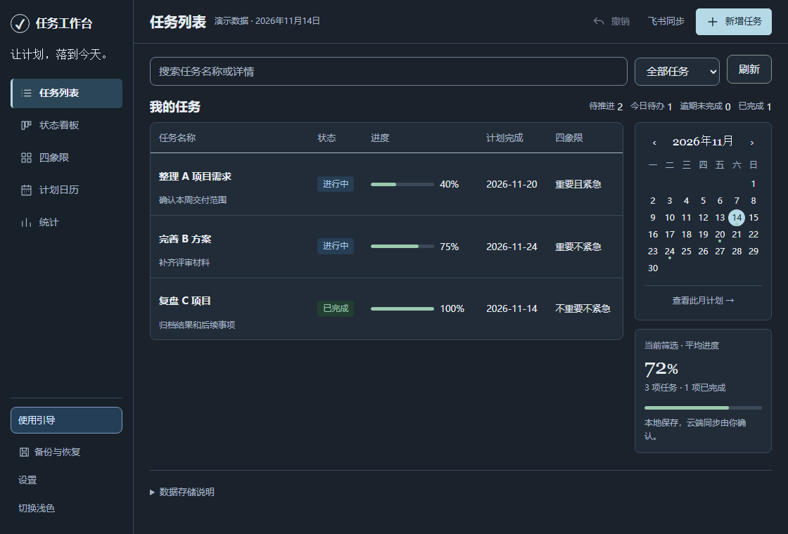
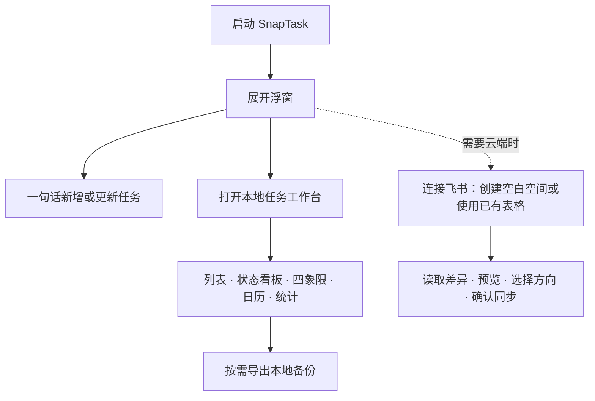
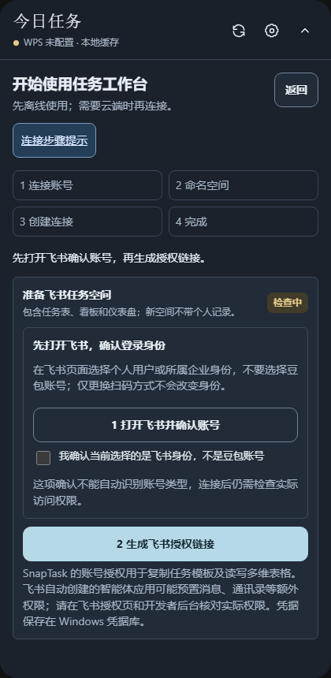
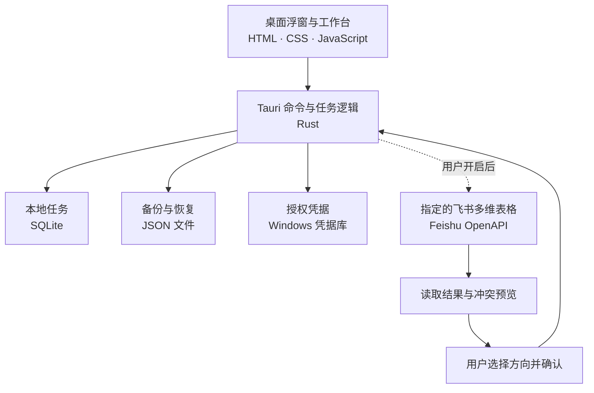

# SnapTask

**让计划，落到今天。**

SnapTask 是一款面向 Windows 的本地优先任务工作台。用桌面浮窗随手记录任务和进度，在工作台中通过列表、状态看板、四象限、计划日历和统计视图查看安排。无需登录即可使用本地功能；需要云端协作时，可以连接飞书并预览、确认同步内容。

> SnapTask is a local-first Windows task workbench with a floating quick-capture window, visual progress tracking, and user-confirmed Feishu sync.

[下载 Windows 安装版或免安装版](https://github.com/talenlin/SnapTask/releases/tag/v0.2.2-rc.1) · 当前为 0.2.2 预发布版

## 界面预览



*演示数据：A 项目、B 方案和 C 项目均为通用示例，不对应真实任务。*

## 功能

- **快速记录**：在常驻浮窗中输入一句话和完成后进度，确认后新增任务或更新已有任务。
- **本地工作台**：任务列表、状态看板、四象限、计划日历和统计视图；本地数据可备份与恢复。
- **任务调整**：进度、状态、计划日期和任务分类可以在本地管理，并支持撤销适用的操作。
- **飞书同步**：读取指定多维表格，预览待导入或待更新的记录，由用户确认同步方向和内容。遇到冲突或结果无法核实时暂停写入。
- **按需使用**：本地任务不依赖飞书或 WPS；WPS 集成保留为后续完善项。

## 使用方式



1. 启动 SnapTask，在浮窗中选择“打开本地任务工作台”。
2. 在工作台新增任务，或在浮窗里输入工作描述和完成后总进度。
3. 需要飞书同步时，在设置中先打开飞书确认登录身份，再生成并打开授权链接。授权完成后可一键创建空白个人任务空间，或连接已有多维表格；随后在同步面板读取、预览并确认记录。同步不会因打开窗口而自动上传任务。
4. 在“备份与恢复”中导出本地备份，妥善保存备份文件。

飞书连接请使用飞书个人或企业身份，豆包账号不适用于当前创建流程。SnapTask 的用户授权请求用于复制任务模板以及访问多维表格；飞书自动创建的智能体应用可能另带消息、通讯录等预置权限。授权前请在飞书页面核对实际清单，并在开发者后台的“权限与范围”中检查应用已开通的权限。实际权限取决于飞书页面及账号配置。

### 飞书连接顺序



*未授权状态的界面示意，不含真实账号或授权码。* 先点“打开飞书并确认账号”，再勾选身份确认并生成授权链接；打开生成的页面完成授权后，才创建任务空间。连接成功不等于本地任务已上传。

## 技术与数据

桌面端使用 Rust、Tauri 2 和系统 WebView2；任务保存在本机 SQLite 数据库中。云端连接属于可选功能。请勿将个人数据库、备份文件、应用密钥或访问令牌提交到公开仓库。

### 实现路径



本地记录无需登录即可使用。飞书同步先读取并展示差异；只有确认对应操作后才写入本地或云端，遇到冲突或写入结果无法核实时暂停。

## 开发构建

在 Windows 上安装 Rust 和 Tauri 2 所需的系统依赖后，在 `src-tauri` 目录运行。公开发布时将编译信息里的本机用户目录映射为通用名称：

```powershell
$env:CARGO_ENCODED_RUSTFLAGS = "--remap-path-prefix=$env:USERPROFILE=build-user"
cargo tauri build
Remove-Item Env:CARGO_ENCODED_RUSTFLAGS
```

## 公开源码说明

本源码包不含个人任务数据、账号凭据或历史验收材料。内置的 [SnapTask 个人任务模板（空白）](https://my.feishu.cn/base/SFXybzuvmaJaxps1RNZcRipD6Ed) 仅供一键创建复制结构，源表无任务记录，持链接可阅读。复制后的空间归创建者管理；使用者需自行完成飞书应用授权，创建并非登录后自动发生。不要把个人任务或密钥写进公开模板。

公开版本使用独立应用标识，不会自动读取旧安装版的本地数据库；迁移任务请在旧版导出备份，并在新版预览后确认恢复。

公开源码不附带历史安装包。发布安装版或免安装版时，须从这份脱敏源码重新构建并复核产物。
